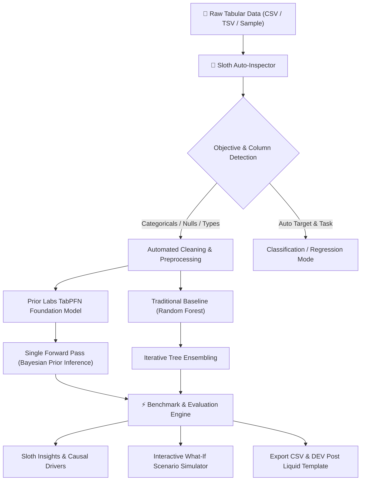

# 🦥 SlothPFN: Zero-Effort Tabular AI Agent with TabPFN

[](https://dev.to/challenges/hacktoberfest-week3-2026-10-19)
[](https://priorlabs.ai)
[](https://opensource.org/licenses/MIT)

> **"Channel your inner sloth. Build something that does the work so you don't have to."**  
> *Submitted for the [Hacktoberfest Open-Source AI Challenge Week 3: Slow and Steady](https://dev.to/challenges/hacktoberfest-week3-2026-10-19) & the **Best Use of TabPFN** Partner Track.*

---

## 🌟 Executive Summary

Traditional tabular machine learning is exhausting. Before you can evaluate a single prediction, you are forced into a tedious gauntlet:
- Imputing missing values
- Encoding categorical strings (One-Hot, Target, Ordinal)
- Scaling numeric distributions
- Iterating through hyperparameter grids (tree depths, learning rates, subsamples)
- Cross-validation splits and overfitting checks

**SlothPFN changes the game.** Powered by Prior Labs' open-weight **TabPFN** (Prior-data Fitted Network) foundation model, SlothPFN allows developers and analysts to drop any raw CSV and do **literally nothing**. 

In less than 2 seconds, SlothPFN's pre-trained Bayesian transformer infers column semantics, auto-detects classification or regression objectives, calculates calibrated class probabilities, and serves a modern, interactive dashboard with an interactive "What-If" scenario simulator.

---

## 🏗️ System Architecture



---

## ✨ Key Features

1. **Zero-Touch Ingestion & Target Inference**:
   - Drag & drop any CSV or launch with 1-click built-in realistic datasets (Customer Churn, Real Estate Valuation, Cardiac Health Risk).
   - Intelligently filters uninformative IDs and determines whether the objective is classification or continuous regression.
2. **Prior Labs TabPFN-3.5 Foundation Model**:
   - Uses pre-trained causal Bayesian transformer priors to produce calibrated posterior probabilities in a single forward pass without iterative gradient descent.
   - Dual-engine support: Connect your free Prior Labs token for live TabPFN-3.5 weights with Thinking Mode, or test offline using the local demo prior simulator.
3. **Sloth vs Traditional Baseline Benchmark**:
   - Instant head-to-head comparison against classical Random Forest / Gradient Boosting baselines.
   - Highlights inference latency, accuracy/R², and estimated time saved.
4. **Explainable "Lazy Insights"**:
   - Natural language executive summaries explaining the top causal feature drivers in plain English.
5. **Interactive What-If Scenario Simulator**:
   - Real-time sliders and selectors for all feature attributes.
   - Instant live posterior recalculation with probability distribution meters.
6. **One-Click DEV Submission Generator**:
   - Generates pre-filled markdown conforming to the official Hacktoberfest Week 3 template with Liquid tags.

---

## 🚀 Quickstart Guide

### 1. Prerequisites
- Python 3.10+ (tested on Python 3.14)
- Git

### 2. Clone & Setup Virtual Environment
```bash
git clone https://github.com/your-username/slothpfn.git
cd slothpfn

# Create and activate virtual environment
python -m venv .venv
# On Windows:
.\.venv\Scripts\activate
# On Linux/macOS:
source .venv/bin/activate

# Install dependencies
pip install -r requirements.txt
```

### 3. Launch the Application
```bash
# Start FastAPI and the Web Dashboard
uvicorn backend.main:app --host 127.0.0.1 --port 8000 --reload
```

Open your browser to: **[http://127.0.0.1:8000](http://127.0.0.1:8000)**

---

## 🔑 Prior Labs TabPFN Authentication (Optional via `.env`)

SlothPFN works immediately out of the box in **Prior Simulator Mode**. To connect live TabPFN-3.5 foundation weights:
1. Register or log in at [ux.priorlabs.ai](https://ux.priorlabs.ai)
2. Accept the non-commercial license on the **Licenses** tab
3. Copy your API key from [ux.priorlabs.ai/account](https://ux.priorlabs.ai/account)
4. Add your key to your local `.env` file (see `.env.example`):
   ```env
   TABPFN_TOKEN="your_api_key_here"
   ```
SlothPFN automatically detects the token upon startup or page reload.

---

## 📁 Repository Structure

```
├── backend/
│   ├── __init__.py
│   ├── main.py              # FastAPI server, REST API & static file mounts
│   ├── predictor.py         # TabPFN engine, feature encoding & simulator
│   └── dataset_samples.py   # One-click sample datasets catalog
├── frontend/
│   ├── index.html           # Modern dark-mode dashboard UI
│   ├── style.css            # Glassmorphic CSS design system
│   └── app.js               # Reactive state, Chart.js integrations & API calls
├── sample_data/
│   ├── telecom_customer_churn.csv
│   ├── housing_prices.csv
│   └── heart_disease_risk.csv
├── requirements.txt         # Pinned Python dependencies
├── LICENSE                  # MIT License
└── README.md                # Documentation
```

---

## 💡 Why Open Innovation Matters

In enterprise and personal machine learning, tabular data frequently contains sensitive, proprietary information: patient vitals, customer financial history, private logs, and pricing data.

Sending raw tabular records across closed third-party cloud APIs presents significant privacy, compliance (GDPR/HIPAA), and cost risks. Open-source tabular foundation models like **TabPFN** prove that world-class Bayesian inference can run **entirely locally on commodity hardware**, offline, with zero subscription fees, empowering builders with true digital sovereignty.

---

## 🏆 Hacktoberfest Week 3 Challenge Alignment

- **Prompt:** Build something with open-source AI at its core.
- **Theme:** *Slow and Steady* (rewards laziness by automating tedious manual data science workflows).
- **Partner Track:** Best Use of TabPFN (Prior Labs $200 prize category).
- **Required Tags:** `#devchallenge`, `#hf26challenge`

---

## 📜 License
Distributed under the MIT License. See [LICENSE](LICENSE) for more details.
